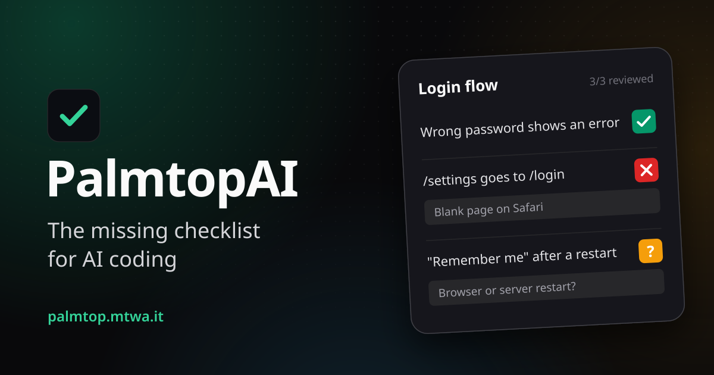

# PalmtopAI

**Nothing your agent builds should go unchecked.**

[](https://github.com/talon2295/palmtopai/actions/workflows/ci.yml)
[](LICENSE)

Your coding agent puts a checklist of what to verify on your phone, tablet or browser. Keep it at
hand while you test, mark what works, what doesn't or what needs a question, and the agent reads
your review and fixes the rest.



[Website](https://palmtop.mtwa.it) · [Docs](https://palmtop.mtwa.it/docs) ·
[Changelog](https://palmtop.mtwa.it/changelog) · [Roadmap](https://palmtop.mtwa.it/#roadmap)

## Why

An agent saying it fixed something is not the same as the fix working. Between "it edited the file"
and "it behaves the way I wanted" there is a gap that automated tests don't close: someone has to
try the work.

palmtop is that human layer, on top of your tests. It doesn't run tests itself: the agent does the
work, then puts a checklist of what to verify on your devices. You try each item on your project and
mark it, and the agent reads your review and fixes what failed. Automated tests still run as usual;
palmtop covers what they miss.

## How it works

1. **You ask** the agent for some work and for the checks, in the chat.
2. **The agent writes checks** with `palmtop`: one thing to try per item, with what should happen.
   For a decision it can ask a **question** with options instead.
3. **You try** and mark each item on any of your devices (works, doesn't work, question), with a
   note where useful. Devices stay in sync, and you can add checks of your own.
4. **You tell the agent** you are done (a **Review done** button in the app, or in the chat), and
   it reads the review with `palmtop feedback`, fixes what doesn't work, answers your questions and
   asks you to check again.

You can also give a client, a colleague or a friend a copy of a checklist: they check it on their
own device and see only that, and you see what each of them answered.

Claude Code and Codex get a ready-made skill and the palmtop tools (an MCP server, `palmtop mcp`);
any other agent can use the tools or the `palmtop` commands (see `palmtop guide`).

## Install

macOS, Linux or Windows, with Node.js 22 or newer. On macOS, Linux or WSL:

```sh
curl -fsSL https://palmtop.mtwa.it/install.sh | bash
```

On Windows, in PowerShell:

```powershell
irm https://palmtop.mtwa.it/install.ps1 | iex
```

The installer downloads one JavaScript file into `~/.palmtopai/bin`, checks its SHA-256, sets up
your agents and pairs a device with a QR code. It never uses `sudo`; you can
[read it](apps/site/public/install.sh) first, or [install by hand](https://palmtop.mtwa.it/docs/getting-started#install-by-hand).

## Architecture

```text
Your computer                      Relay                        Your devices
agent ─ palmtop CLI                forwards messages            web app
          │  127.0.0.1             over TLS, one room           paired with
          ▼                        per computer                 a QR code
      palmtop daemon  ◄── wss ───►                ◄── wss ───►
      ~/.palmtopai
```

- **The daemon** keeps everything on your computer, in `~/.palmtopai`. It listens only on
  `127.0.0.1` and connects out to the relay: nothing on your network is opened.
- **The relay** forwards messages between the daemon and your devices. It keeps rooms in memory
  only and never logs message contents.
- **The app** is a web app (installable on the Home Screen) that syncs operations, works offline and
  sends what you did when it is back online.

| Path | What |
|---|---|
| `packages/protocol` | Operations, `apply()`, message schemas (zod), shared by everything |
| `packages/daemon` | Storage, Local API for the CLI, device hub, relay link, push notifications |
| `packages/client` | Sync client used by the app |
| `packages/cli` | The `palmtop` command, bundled with the daemon into one file for Node.js 22+ |
| `integrations/agent-guide` | The instructions for agents (`palmtop guide`) |
| `integrations/agents` | Skill, permissions and MCP server setup for Claude Code and Codex |
| `apps/relay` | The relay (Bun): rooms, pairing codes, the site and the CLI downloads |
| `apps/web` | The app (React, Vite, Tailwind, shadcn/ui) |
| `apps/site` | The website and docs (Astro) |

A map of the code, the data flow and the encryption: [docs/architecture.md](docs/architecture.md).

## Security

Everything between your computer and your devices is **end-to-end encrypted** (since 0.18): the
relay forwards data it can't read and stores nothing. Each device has its own key, made in the
browser and impossible to copy out of it, and can be revoked on its own (`palmtop devices remove`).
Only WebCrypto: Ed25519, X25519 at every connection, HKDF-SHA-256, AES-256-GCM. The protocol is in
[`packages/protocol/src/e2e.ts`](packages/protocol/src/e2e.ts).

Pairing links carry a single-use key in the URL fragment, which the device proves without sending
it; pairing with a code adds a 6-digit number to compare on both screens. The QR page is served
only on `127.0.0.1`, and pairing links never reach the agent's context. Details in the
[security docs](https://palmtop.mtwa.it/docs/security). To report a vulnerability, see
[SECURITY.md](SECURITY.md).

## Running your own relay

The relay is in this repository, with its deploy script and an nginx example: see
[apps/relay/README.md](apps/relay/README.md). The address of the relay is compiled into the CLI
(`DEFAULT_RELAY_URL` in `packages/daemon/src/config.ts`), so build the CLI with your address and
install that build.

## Development

Requires [Bun](https://bun.sh) 1.4.2 or newer.

```sh
bun install
bun run test         # unit, integration and end-to-end tests
bun run typecheck
bun run lint         # Biome, 4-space indentation
bun run dev:relay    # local relay on 127.0.0.1:8787
bun run dev:web      # the app, proxied to the local relay
bun run build:cli    # packages/cli/dist/palmtop.mjs
```

`PALMTOP_RELAY_URL=ws://localhost:8787` points the CLI at a local relay (development only); the app
is then at `http://app.localhost:8787`.

palmtop is built with Claude Code, and every phase is checked on real devices with palmtop itself.
See [CONTRIBUTING.md](CONTRIBUTING.md) to contribute.

## License

[Apache License 2.0](LICENSE). You can use, modify, redistribute and self-host palmtop, for personal
or commercial use. The PalmtopAI name and logo are not covered by the license: a fork has to use
its own name. The licenses of the packages shipped with palmtop are in
[THIRD_PARTY_NOTICES.md](THIRD_PARTY_NOTICES.md).

PalmtopAI is an independent project. It is not affiliated with, endorsed by or sponsored by
Anthropic or OpenAI. Claude and Claude Code are trademarks of Anthropic; Codex and OpenAI are
trademarks of OpenAI.
